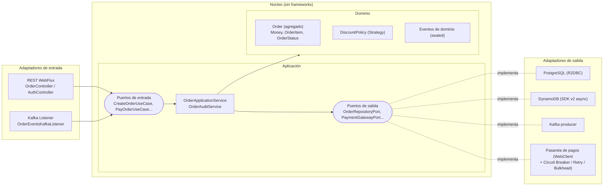
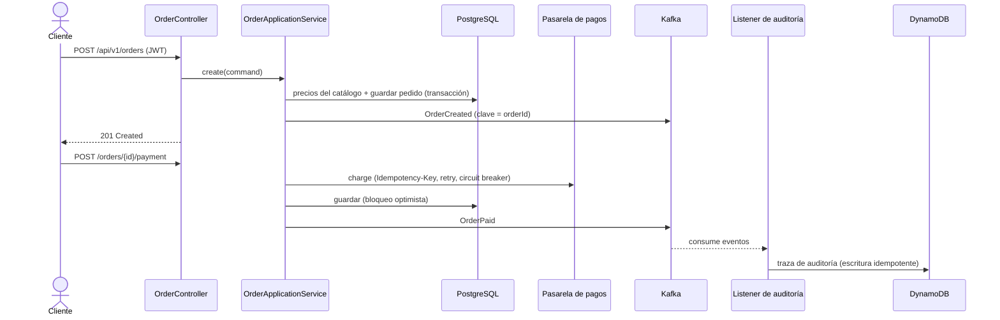

# Orders Service

Microservicio **reactivo** de gestión de pedidos construido con **Java 21 + Spring Boot 3.5 (WebFlux)** siguiendo
**Arquitectura Hexagonal / Clean Architecture**. Permite crear, pagar, cancelar y consultar pedidos; publica eventos
de dominio en **Kafka** y construye una traza de auditoría en **DynamoDB**.

 


---

## Arquitectura



**Regla de dependencias:** `infrastructure → application → domain`. El dominio es Java puro y la capa de aplicación
solo conoce puertos (interfaces). Estas reglas **no son una convención**: las verifica `HexagonalArchitectureTest`
(ArchUnit) en cada build.

### Flujo de un pedido



### Estructura

```
src/main/java/com/cmanzano/orders
├── domain/                     # Modelo de negocio: Java puro, sin dependencias
│   ├── model/                  # Order (agregado + Builder), Money, OrderItem, OrderStatus...
│   ├── event/                  # DomainEvent (sealed) y sus records
│   ├── policy/                 # DiscountPolicy: Strategy + Composite + Factory
│   └── exception/
├── application/                # Casos de uso: solo dependen del dominio y de puertos
│   ├── port/in/                # Puertos de entrada (un interface por caso de uso)
│   ├── port/out/               # Puertos de salida (persistencia, pagos, eventos)
│   └── service/                # Orquestación de casos de uso
└── infrastructure/             # Detalles técnicos intercambiables
    ├── adapter/in/web/         # REST WebFlux, DTOs, manejo de errores RFC 9457
    ├── adapter/in/messaging/   # Consumidor Kafka
    ├── adapter/out/persistence/postgres/   # R2DBC
    ├── adapter/out/persistence/dynamodb/   # AWS SDK v2 asíncrono
    ├── adapter/out/payment/    # WebClient + Resilience4j
    ├── adapter/out/messaging/  # Productor Kafka
    ├── security/               # JWT (emisión y validación), Spring Security
    ├── aop/                    # Aspecto de observabilidad
    └── config/                 # Composition root (wiring de puertos y adaptadores)
```

---

## Cómo se cubre cada competencia

| Competencia | Dónde verlo |
|---|---|
| **POO**: encapsulamiento | `Order` no expone setters; el estado cambia solo con métodos de negocio (`markAsPaid`, `cancel`) que protegen sus invariantes. Colecciones inmutables. |
| **POO**: herencia | Jerarquía `DomainException` → `InvalidOrderException`, `OrderNotFoundException`... |
| **POO**: polimorfismo | `OrderStatus` define `canTransitionTo` por constante; implementaciones intercambiables de `DiscountPolicy` y de cada puerto. |
| **POO**: abstracción | Puertos (`OrderRepositoryPort`, `PaymentGatewayPort`) ocultan PostgreSQL, HTTP, Kafka o DynamoDB. |
| **Clean / Hexagonal Architecture** | Paquetes `domain` / `application` / `infrastructure`; composition root en `ApplicationConfig`; reglas en `HexagonalArchitectureTest`. |
| **Spring WebFlux (reactivo)** | Todo el flujo es no bloqueante: WebFlux + R2DBC + WebClient + DynamoDB async. `KafkaTemplate.send` se aísla en `boundedElastic`. |
| **Programación funcional** | Records inmutables, `DiscountPolicy` como `@FunctionalInterface`, pipelines Reactor, `switch` con pattern matching sobre `sealed`. |
| **Programación orientada a aspectos** | `UseCaseObservabilityAspect`: mide duración y resultado de cada caso de uso (logs + métrica Micrometer) sin tocar la capa de aplicación. |
| **JWT** | `JwtTokenService` emite tokens HS256 (15 min, claim `roles`); `SecurityConfig` valida firma, expiración y emisor; autorización por rol con `@PreAuthorize`. |
| **PostgreSQL** | R2DBC + Flyway, transacción reactiva (`TransactionalOperator`), bloqueo optimista (`@Version`), índices. |
| **DynamoDB** | Tabla con PK/SK diseñada para el patrón de acceso, escritura idempotente, cliente asíncrono. |
| **Patrones GoF** | Strategy y Composite (`DiscountPolicy`, `BestDiscountPolicy`), Builder (`Order.Builder`), Factory Method (`Order.create`, `DiscountPolicies`), Adapter (todos los adaptadores), Decorator (operadores Resilience4j). |
| **Tolerancia a fallos** | `HttpPaymentGatewayAdapter`: Circuit Breaker + Retry con backoff exponencial + Bulkhead + Timeout, e `Idempotency-Key` para evitar cobros dobles. |
| **EDA (Kafka)** | Eventos publicados con clave `orderId` (orden por pedido), productor idempotente (`acks=all`), consumidor con reintentos y **Dead Letter Topic**. |
| **Pruebas unitarias (JUnit 5 + Mockito)** | `OrderTest`, `MoneyTest`, `DiscountPolicyTest` (parametrizado), `OrderApplicationServiceTest` (mocks + `StepVerifier`). |
| **Pruebas de integración** | `OrdersApiIT`: Testcontainers (PostgreSQL, Kafka, DynamoDB Local) + WireMock, flujo HTTP → Kafka → DynamoDB. `HttpPaymentGatewayAdapterTest` con WireMock y Resilience4j real. |
| **BDD (Cucumber)** | `src/test/resources/features/pedidos.feature` en español, ejecutado contra los casos de uso reales con *fakes* en memoria. |
| **Docker** | `Dockerfile` multi-stage, jar extraído en capas, imagen **Distroless** `nonroot`. |
| **Kubernetes** | `k8s/`: Deployment con probes, `readOnlyRootFilesystem`, sin root, HPA, PDB, Kustomize. |
| **IaC (Terraform)** | `infra/terraform`: DynamoDB (PITR, cifrado), ECR (escaneo al subir, tags inmutables), rol IAM (IRSA) de mínimo privilegio. |
| **CI/CD (GitHub Actions)** | `.github/workflows/ci.yml`: build + todas las pruebas, escaneo Trivy (dependencias, secretos, IaC, imagen), publicación en GHCR desde `main`. Dependabot. |
| **Git / GitFlow** | [docs/BRANCHING.md](docs/BRANCHING.md). |
| **OWASP Top 10** | Ver sección siguiente. |

### Seguridad (OWASP Top 10)

| Riesgo | Mitigación |
|---|---|
| A01 Broken Access Control | Un cliente solo accede a sus pedidos (`Requester.canAccess`); para pedidos ajenos se responde **404** y no 403, para no revelar su existencia. Auditoría solo para `ADMIN`. |
| A02 Cryptographic Failures | Secreto JWT de ≥256 bits inyectado por entorno (la app no arranca sin él); contraseñas con BCrypt. |
| A03 Injection | Consultas parametrizadas (Spring Data R2DBC); validación de entrada con Bean Validation (SKU con patrón, límites de cantidad y tamaño). |
| A04 Insecure Design | El precio **nunca** viene del cliente: se toma del catálogo. Descuento acotado al subtotal. |
| A05 Security Misconfiguration | Errores RFC 9457 sin trazas internas; actuator restringido; contenedor sin root ni shell. |
| A06 Vulnerable Components | Trivy en CI + Dependabot. |
| A07 Authentication Failures | Tokens de vida corta, validación de `exp`, `iss` y firma. |
| A08 Data Integrity | Escaneo de la imagen antes de publicarla; tags inmutables en ECR. |
| A09 Logging & Monitoring | Logs estructurados por caso de uso, métricas Prometheus, métrica de eventos no publicados. La contraseña se enmascara en `TokenRequest.toString()`. |

---

## Ejecutarlo

**Requisitos:** Java 21, Maven 3.9+, Docker.

```bash
# 1. Infraestructura local (PostgreSQL, Kafka, DynamoDB Local, pasarela de pagos simulada)
docker compose up -d

# 2. La aplicación (perfil local: usuarios demo y creación de la tabla DynamoDB)
mvn spring-boot:run -Dspring-boot.run.profiles=local

# Alternativa: todo en contenedores, incluida la app
docker compose --profile app up -d --build
```

- Swagger UI: http://localhost:8080/swagger-ui.html
- Health: http://localhost:8080/actuator/health
- Métricas: http://localhost:8080/actuator/prometheus
- Peticiones de ejemplo: [docs/api.http](docs/api.http)

Usuarios de demostración (solo perfil `local`): `alice / alice123`, `bob / bob123` (USER) y `admin / admin123` (USER, ADMIN).

```bash
TOKEN=$(curl -s -X POST localhost:8080/api/v1/auth/token -H 'Content-Type: application/json' \
  -d '{"username":"alice","password":"alice123"}' | jq -r .accessToken)

curl -s -X POST localhost:8080/api/v1/orders -H "Authorization: Bearer $TOKEN" -H 'Content-Type: application/json' \
  -d '{"items":[{"sku":"MOUSE-01","quantity":8},{"sku":"MONITOR-27","quantity":2}]}' | jq
```

### Pruebas

```bash
mvn test      # unitarias, ArchUnit y Cucumber (sin Docker, segundos)
mvn verify    # + integración con Testcontainers (requiere Docker) + reporte JaCoCo
```

Reportes: `target/site/jacoco/index.html` (cobertura) y `target/cucumber-report.html` (BDD).

### Kubernetes (minikube)

```bash
docker build -t ghcr.io/cmanzano/orders-service:1.0.0 .
minikube image load ghcr.io/cmanzano/orders-service:1.0.0
kubectl apply -f k8s/namespace.yaml
kubectl -n orders create secret generic orders-service-secrets \
  --from-literal=DB_USERNAME=orders --from-literal=DB_PASSWORD=orders \
  --from-literal=JWT_SECRET="$(openssl rand -base64 48)"
kubectl apply -k k8s/
```

> Los manifiestos asumen PostgreSQL, Kafka y DynamoDB como servicios gestionados (RDS, MSK, DynamoDB).

---

## Decisiones de diseño y trade-offs

- **Reactor en los puertos.** La capa de aplicación usa `Mono`/`Flux` como contrato asíncrono. Es una concesión
  pragmática: Reactor es una librería, no un framework, y evita bloquear o convertir tipos en cada frontera.
- **Un servicio de aplicación con varios puertos de entrada.** Cada caso de uso tiene su interfaz, de modo que los
  adaptadores dependen solo de lo que usan (ISP). Si la clase creciera, se dividiría por caso de uso sin tocar a los clientes.
- **Modelo de persistencia separado del dominio.** Más mapeo, a cambio de que el dominio no tenga anotaciones de JPA/R2DBC.
- **404 en lugar de 403** para recursos ajenos: evita la enumeración de IDs.
- **Monolito modular en un solo módulo Maven.** Las fronteras se garantizan con ArchUnit. Separarlo en módulos Maven
  (`domain`, `application`, `infrastructure`) añadiría verificación en tiempo de compilación.

## Limitaciones conocidas y siguientes pasos

- **Transactional Outbox.** Hoy el evento se publica después del commit en PostgreSQL. Si Kafka falla en ese momento,
  el evento se pierde (queda registrado en log y en la métrica `orders.events.publish.failures`). La solución es
  guardar el evento en una tabla *outbox* dentro de la misma transacción y publicarlo con un relay (o Debezium CDC).
- Delegar la autenticación a un IdP (Cognito / Keycloak) con RS256 y JWKS; el servicio quedaría solo como resource server.
- Rate limiting en el endpoint de login.
- Trazabilidad distribuida con OpenTelemetry.
- Pruebas de contrato (Spring Cloud Contract / Pact) con el proveedor de pagos.
