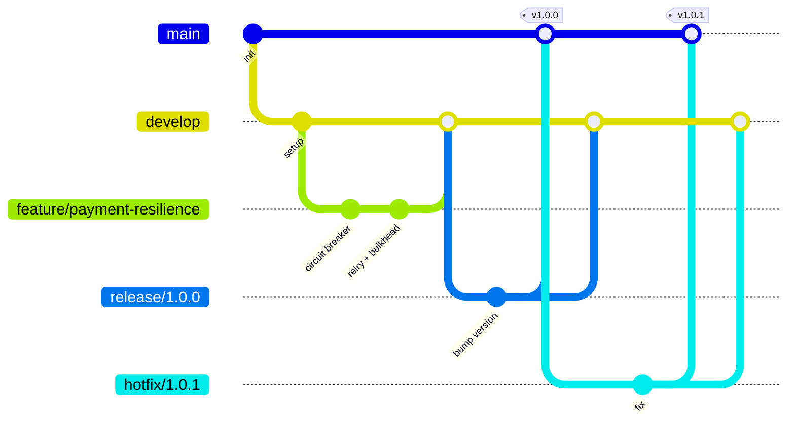

# Estrategia de ramas: GitFlow

| Rama | Origen | Se integra en | Propósito |
|------|--------|---------------|-----------|
| `main` | — | — | Código en producción. Cada merge se etiqueta (`vX.Y.Z`). |
| `develop` | `main` | — | Integración continua de la siguiente versión. |
| `feature/*` | `develop` | `develop` | Una funcionalidad o historia de usuario. |
| `release/*` | `develop` | `main` y `develop` | Estabilización de una versión (solo fixes). |
| `hotfix/*` | `main` | `main` y `develop` | Corrección urgente en producción. |

## Reglas

- Ramas `main` y `develop` protegidas: merge solo por Pull Request con el pipeline de CI en verde y al menos una revisión.
- Mensajes de commit con [Conventional Commits](https://www.conventionalcommits.org/): `feat:`, `fix:`, `test:`, `refactor:`, `docs:`, `ci:`, `chore:`.
- Versionado semántico (SemVer).
- El pipeline (`.github/workflows/ci.yml`) corre en `main`, `develop`, `release/**`, `hotfix/**` y en cada PR; solo `main` publica la imagen.

## ¿Y Trunk Based Development?

Con TBD todos integran en `main` varias veces al día mediante ramas de vida muy corta (horas) y
feature flags para ocultar trabajo incompleto. Exige un pipeline rápido y muy confiable. GitFlow
encaja mejor cuando hay versiones planificadas y varios entornos; TBD cuando se despliega de forma
continua. Este repositorio usa GitFlow, pero el pipeline es compatible con ambos modelos.
